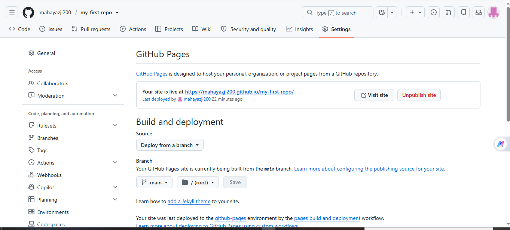

# my-first-repo

أول مستودع لي على GitHub، موقع بسيط أنشأته لتعلم أساسيات Git و GitHub.

## رابط الموقع

https://mahayazji200.github.io/my-first-repo/

## التقنيات المستخدمة

- HTML
- CSS
- Git
- GitHub Pages

## صورة الموقع

## الطالبة

الاسم: مها يازجي

حساب GitHub: mahayazji200
